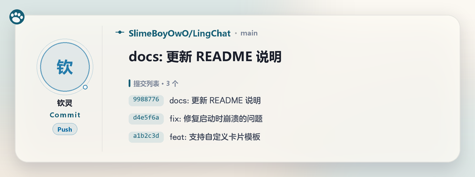
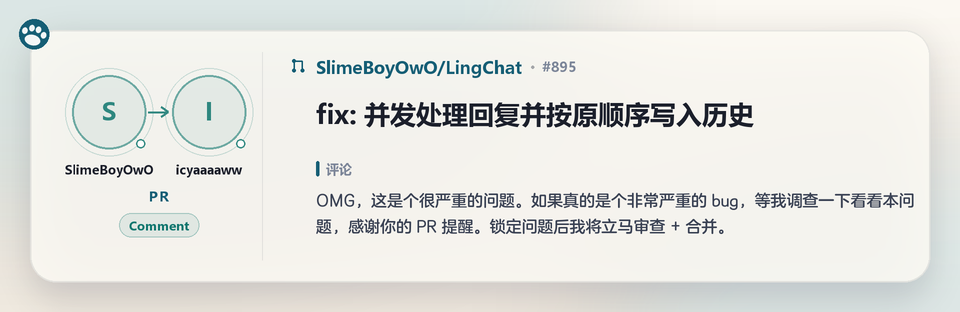
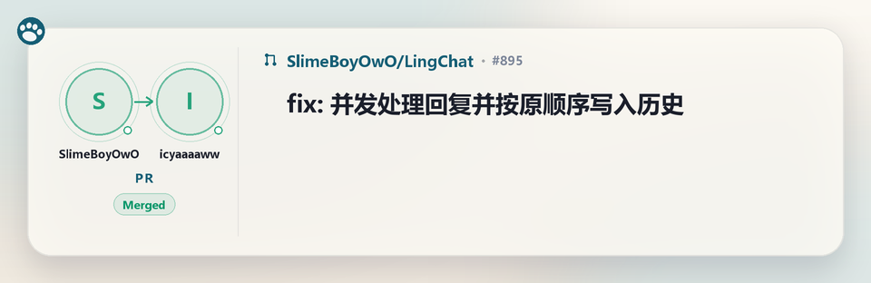

# astrbot_plugin_github_ling

绑定 GitHub 仓库到聊天会话，把 **Commit / PR / Issue** 更新以卡片形式推送到群里。

- **Commit**：卡片展示短哈希 + 提交信息（`feat: xxx` / `fix: xxx`），一次推送多个提交时合并为一张卡片。
- **PR / Issue**：卡片顶部是大标题，下面展示评论（或描述）的**前 10 行**，超出部分提示省略行数。
- 支持**轮询**（默认，无需公网）与 **Webhook**（实时、评论更全面）两种模式。
- 卡片使用 AstrBot 内置文转图服务渲染；渲染失败时自动退回纯文本。

## 安装

把整个 `astrbot_plugin_github_ling` 文件夹放到 AstrBot 的 `data/plugins/` 目录下，
在管理面板重载插件即可。无需额外依赖（`aiohttp` 为 AstrBot 自带）。

- 插件图标：根目录的 **`logo.png`**（AstrBot 只识别这个文件名，重载后才会读取）
- 显示名称：`metadata.yaml` 里的 `display_name: Github 读写插件 - 灵`
  （目录名 / `name` 仍是 `astrbot_plugin_github_ling`，命令与配置不受影响）

## 命令

| 命令 | 说明 |
| --- | --- |
| `/ghbind 用户名/仓库名` | 绑定仓库到当前会话，也支持直接粘贴 `https://github.com/用户名/仓库名` |
| `/ghbind 用户名/仓库名 force` | 跳过 API 校验直接绑定；服务器连不上 `api.github.com` 时配合 Webhook 模式使用 |
| `/ghunbind [用户名/仓库名]` | 取消绑定；省略参数则取消当前会话的全部绑定 |
| `/ghbindlist` | 查看当前会话绑定的仓库 |
| `/ghpush on` / `off` / `list` | 把**当前会话**（通常是某个群）加入/移出额外推送目标，查看全部目标 |
| `/ghcheck` | 立即检查一次更新（轮询模式） |
| `/ghrewind [分钟]` | 把当前会话的水位线回退 N 分钟（默认 10），找回漏掉的更新 |
| `/ghstatus` | 查看运行模式、间隔、Token、代理、API 连通性与剩余额度 |

绑定后，该会话会收到仓库的 Commit、PR、Issue 更新推送。

## 推送到指定群聊

默认情况下，更新只推送给**执行 `/ghbind` 的那个会话**：在私聊里绑定，就只有私聊收到。
想让某个群也收到，两种办法。

**方式一：直接在群里发命令（推荐）**

```
/ghpush on      # 让本群也接收推送（所有已绑定仓库的更新都会推到这里）
/ghpush off     # 取消
/ghpush list    # 查看当前所有推送目标
```

**方式二：在插件配置里填 `push_targets`**

每项支持三种写法：

| 写法 | 说明 |
| --- | --- |
| `aiocqhttp:GroupMessage:123456789` | 完整会话标识（`unified_msg_origin`），任何平台都适用 |
| `group:123456789` / `private:123456789` | 简写，也认 `群:`、`群聊:`、`私聊:` |
| `123456789` | 纯数字，按群聊处理 |

简写需要知道平台 ID（如 `aiocqhttp`、`telegram`），可填在 `push_platform`；
留空时插件先取已绑定会话的平台，再退到第一个已加载的平台适配器。

几点约定：

- 额外目标是**全局的**：收到的是所有已绑定仓库的更新，不区分仓库；
- 至少要在某个会话里 `/ghbind` 过，否则插件不会去检查任何仓库；
- 和已绑定的会话重复时自动去重，不会推两遍；
- 目标失效（退群、封号）只会在日志里报错，不影响其他会话的推送。

## 配置

| 配置项 | 默认值 | 说明 |
| --- | --- | --- |
| `github_token` | 空 | 建议填写。限额从 60 次/小时提升到 5000 次/小时，并可访问私有仓库 |
| `github_proxy` | 空 | 服务器无法直连 `api.github.com` 时填写，例如 `http://127.0.0.1:7890` |
| `github_ca_bundle` | 空 | 报 `CERTIFICATE_VERIFY_FAILED` 时，填写代理/企业根证书 PEM 文件路径 |
| `github_ssl_verify` | `true` | 仅在证书问题无法解决时临时关闭，关闭后存在中间人风险 |
| `check_interval` | `10` | 轮询间隔（分钟），仅在轮询模式下生效 |
| `send_card_image` | `true` | 关闭后直接发送纯文本 |
| `card_style` | `ling` | `ling` = 内置米白毛玻璃卡片（离线渲染，推荐）；`markdown` = 交给 AstrBot 文转图 |
| `card_width` | `960` | 卡片宽度（像素），仅 `ling` 风格生效 |
| `comment_line_limit` | `10` | PR/Issue 卡片中展示的评论行数 |
| `max_commits_per_card` | `5` | 单张提交卡片最多展示的提交数 |
| `poll_comments` | `true` | 轮询时为有更新的 Issue/PR 额外请求一条最新评论 |
| `max_items_per_check` | `3` | 单轮最多为多少个 Issue/PR 拉取最新评论（保护 API 限额） |
| `push_targets` | 空 | 额外推送目标（群聊 / 私聊），详见下文「推送到指定群聊」 |
| `push_platform` | 空 | `push_targets` 用简写时所属的平台 ID，例如 `aiocqhttp`；留空自动推断 |
| `enable_webhook` | `false` | 开启后停止轮询，改由 GitHub 主动推送 |
| `webhook_host` / `webhook_port` / `webhook_path` | `0.0.0.0` / `6193` / `/github/webhook` | Webhook 监听参数 |
| `webhook_secret` | 空 | 用于校验 `X-Hub-Signature-256`，强烈建议设置 |

## Webhook 模式

1. 在插件配置中开启 `enable_webhook`，设置端口、路径与 Secret（可选但推荐）。
2. 确保端口对公网可达（可用反向代理转发到本插件端口）。
3. 在 GitHub 仓库 **Settings → Webhooks → Add webhook**：
   - **Payload URL**：`http://<你的地址>:6193/github/webhook`
   - **Content type**：`application/json`
   - **Secret**：与插件配置保持一致
   - **Which events**：选择 *Let me select individual events*，勾选
     `Pushes`、`Issues`、`Issue comments`、`Pull requests`、
     `Pull request reviews`、`Pull request review comments`
4. 保存后 GitHub 会发送一次 `ping`，插件日志出现“配置正常”即成功。

Webhook 模式下支持的事件：

- `push` → 提交卡片
- `issues`（新建 / 关闭 / 重新打开 / 编辑）→ Issue 卡片
- `issue_comment`（新建 / 编辑评论）→ Issue / PR 卡片，展示评论前 10 行
- `pull_request`（新建 / 关闭 / 合并 / 重新打开 / 编辑）→ PR 卡片
- `pull_request_review`（提交审查）→ PR 卡片
- `pull_request_review_comment`（审查评论）→ PR 卡片

## 常见问题

**`/ghbind` 提示“无法访问仓库 … 触发 GitHub API 速率限制（HTTP 403）”**

GitHub 对未认证请求只给 60 次/小时，且按出口 IP 共享计算。云服务器经常一启动就已被限流。
在插件配置中填写 `github_token`（任意只读 token 即可）后重载插件。

**`/ghbind` 提示 `CERTIFICATE_VERIFY_FAILED: unable to get local issuer certificate`**

服务器无法验证 GitHub 的证书链，常见于精简容器 / 云镜像缺少 CA 根证书，或处在
HTTPS 中间人代理之后。按顺序尝试：

1. 插件默认会使用 **系统信任库 + certifi** 构建 TLS 上下文，先确认 `certifi` 已随
   AstrBot 正常安装；仍失败则：
2. 在服务器上安装 CA：Debian/Ubuntu 执行 `apt install -y ca-certificates`，
   Alpine 执行 `apk add ca-certificates`，然后重启 AstrBot；
3. 如果服务器经过代理/企业网关，把其根证书保存为 PEM，在插件配置
   `github_ca_bundle` 中填写绝对路径；
4. 仅作临时排查时，可设置 `github_ssl_verify=false`（不推荐长期使用）。

**`/ghbind` 提示“连接 api.github.com 超时”或“网络错误”**

服务器无法直连 GitHub API。两种办法：

1. 配置 `github_proxy`（如 `http://127.0.0.1:7890`）后重载插件；
2. 如果 GitHub 能主动访问到你的服务器（Webhook 模式可用），可以执行
   `/ghbind 用户名/仓库名 force` 跳过 API 校验直接绑定。

**怎么确认是哪种问题？**

发送 `/ghstatus`。插件会请求 `/rate_limit`（该接口不消耗配额）并显示：

- `API 连通性：正常（核心额度 x/60，HH:MM:SS 重置）` —— 网络可达，额度不足时换 Token；
- `API 连通性：失败 —— 触发 GitHub API 速率限制（HTTP 403）…` —— 需要 Token；
- `API 连通性：失败 —— 连接 api.github.com 超时` —— 需要代理或 force 绑定。


## 卡片样式

默认 `card_style=ling`：插件用 Pillow 自己画图（`card_render.py`），**不依赖 AstrBot 文转图服务**。
设计参考 LingChat 的 `CharacterCard.vue`：

- 米白色背景 + 白色毛玻璃面板（圆角、细描边、柔和投影），左上角猫爪品牌角标
- 左栏：**操作人头像**（GitHub 真实头像，外面一圈细环 + 小圆点装饰；离线时降级为首字母占位）→ 作者名 → 类型（Commit / Issue / PR）→ 操作（Open / Closed / Merged / Comment / Review / Push / Update）
- 在别人的 Issue / PR 上评论、审查，或关闭 / 合并别人的 Issue / PR 时，显示 **操作人 → 原作者** 两个头像并排；自己操作自己的则自动退化成单头像。正文是这次的评论或审查内容，而不是原始的 Issue/PR 描述
- 右栏：类型图标 + `owner/repo · 分支或编号` → 大标题 → Markdown 渲染后的正文（前 N 行）
- 强调色为深青蓝（`#0E7490`）；事件语义色：新建=青、合并=绿、关闭=红、评论=青绿、提交=蓝







头像通过 `https://github.com/{用户名}.png` 拉取（不消耗 API 配额），失败时再退回
`GET /users/{login}` 的 `avatar_url`；下载成功才落盘，缓存到 `data/github_ling_avatars/`
（7 天过期，`data/temp` 可能被清理，所以不放那里），仍失败才用首字母占位，不影响通知。

正文会先按 Markdown 排版（`rich_body.py`），不再直接画出 `##`、`**`、反引号：

- 块级：`#` 标题、`-` 无序列表、`1.` 有序列表、`>` 引用、代码围栏、`---` 分割线
- 行内：`**粗体**`、`` `代码` ``（带浅底）、`[文字](链接)`、`~~删除线~~`

卡片上没有假按钮；提交数 / 编号这类信息放在正文标签或标题行里。
轮询模式下识别不到「具体改了什么」的更新会直接跳过，避免把 PR/Issue 的原始描述当成这次更新推出来。
同一个轮询窗口里既评论又关闭/合并时，合并成一张卡片：状态是 Closed / Merged，正文是那条评论。
新评论通过 `GET /issues/{n}/comments?since=...` 获取（该接口不支持 `sort`/`direction`，必须按 `created_at` 自己取最新一条）。

改样式只需要动 `card_render.py`：顶部是版式常量（`WIDTH`/`MARGIN`/`LEFT_W`/`RADIUS`）与配色表，
`render_card()` 里按「背景 → 毛玻璃 → 左栏 → 右栏 → 胶囊」顺序绘制。

`card_style=markdown` 时退回旧方案：`cards.py` 生成 Markdown，交给 `Star.text_to_image()` 渲染，
视觉样式由 AstrBot 的 `data/t2i_templates/` 模板决定。渲染失败时链条是：
内置渲染 → 文转图 → 纯文本。

### 生成样例

```bash
# 打印样例 Markdown 与纯文本
python tools/preview_cards.py

# 用内置渲染器生成 PNG 卡片，输出到 tools/preview/
python tools/preview_cards.py --render

# 额外渲染旧版 Markdown 卡片做对比
python tools/preview_cards.py --render --render-markdown
```

## 数据

绑定关系与轮询水位线保存在 `data/github_ling_state.json`：

```json
{
  "bindings": {
    "owner/repo": ["aiocqhttp:GroupMessage:123456"]
  },
  "watermarks": {
    "owner/repo": "2026-11-06T01:23:45Z"
  },
  "broadcasts": ["aiocqhttp:GroupMessage:987654321"]
}
```

删除该文件即可清空所有会话的绑定。

## 实现说明

- 时间统一使用带时区的 UTC（`utils.parse_time`），避免本地时区与 GitHub 时间混用导致漏报。
- 轮询水位线使用 **GitHub 响应头里的服务器时间**，不依赖本机时钟；请求失败的一轮**不推进水位线**，下一轮从旧位置重试，避免网络抖动期间漏掉评论。
- 轮询水位线按仓库保存，重启后不会重复推送历史事件；首次绑定只记录时间戳，不补推旧内容。
- 如果怀疑漏了事件，`/ghrewind 10` 回退水位线后再 `/ghcheck` 即可重新检查。
- Webhook 先返回 `200` 再异步处理事件，避免 GitHub 的 3 秒超时重投。
- 卡片渲染：`cards.render_event(..., markdown=True)` 生成 Markdown，交给
  `Star.text_to_image()`；失败时 `render_event(..., markdown=False)` 生成纯文本兜底。
